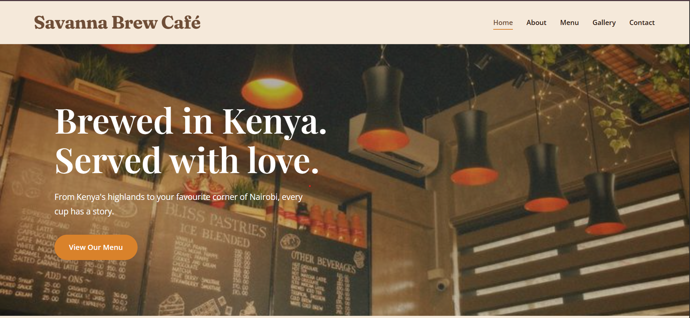

# Savanna Brew Café

Savanna Brew Café is a responsive, five-page website inspired by Kenya's coffee culture. The project focuses on creating a warm and welcoming digital experience through thoughtful design, simple navigation, and an earthy colour palette.

## About the Project

This website was developed as part of my web development learning journey.

The project demonstrates my understanding of HTML5, CSS3, responsive web design, and website structure. It also allowed me to explore typography, colour combinations, layouts, and user-friendly navigation.

Savanna Brew Café is a fictional business created for educational and portfolio purposes.

## Features

- Responsive design for desktop, tablet, and mobile devices
- Five interconnected web pages
- Consistent navigation and footer
- Featured café products
- Café menu with descriptions and prices in Kenyan shillings
- Image gallery
- Table reservation form
- Contact details and opening hours
- Interactive hover effects

## Website Pages

### Home
Introduces Savanna Brew Café, highlights popular products, and encourages visitors to explore the menu or make a reservation.

### About
Shares the café's fictional story, values, and inspiration.

### Menu
Displays hot drinks, cold drinks, and bakery items with descriptions and prices.

### Gallery
Showcases the café atmosphere through a collection of photographs.

### Contact
Provides a reservation form, location information, contact details, and opening hours.

## Technologies Used

- HTML5
- CSS3
- CSS Grid
- Flexbox
- CSS Media Queries
- Google Fonts
- Visual Studio Code
- Google Chrome Developer Tools

## Design and Styling

The website uses an earthy colour palette inspired by coffee, nature, and warm café interiors.

The main colours include:

- Espresso Brown: #542916
- Olive Green: #43533D
- Terracotta: #A13A1E
- Butter Yellow: #F1C166
- Warm Cream: #FEFAF0

The design combines elegant typography, photography, rounded elements, and balanced spacing to create a welcoming café experience.

## Project Structure

    cafe assignment/
    |
    |-- index.html
    |-- about.html
    |-- menu.html
    |-- gallery.html
    |-- contact.html
    |
    |-- css/
    |   |-- style.css
    |
    |-- images/
    |   |-- hero.png
    |   |-- latte.png
    |   |-- cappucino.png
    |   |-- croissant.png
    |   |-- owner.png
    |   |-- gallery-1.png
    |   |-- gallery-2.png
    |   |-- gallery-3.png
    |   |-- gallery-4.png
    |   |-- gallery-5.png
    |   |-- gallery-6.png
    |   |-- gallery-7.png
    |   |-- gallery-8.png
    |
    |-- README.md

## Getting Started

1. Download or clone this repository.
2. Open the project folder in Visual Studio Code.
3. Locate the `index.html` file.
4. Open the file in your preferred web browser.
5. Use the navigation menu to explore the website.

No additional installation is required.

## Acknowledgements and Credits

### Photography and Images

The photographs used in the project's design were discovered through Pinterest.

Pinterest was used as an image discovery and visual inspiration platform. The images are not claimed as original work by the project author.

The photographs include:

- Homepage hero photograph
- Featured coffee and pastry photographs
- About page portrait
- Gallery photographs

The original photographers, copyright holders, and usage permissions have not yet been verified.

Pinterest is not necessarily the original source or copyright owner of images shared on its platform.

Before public deployment, the images should be replaced with appropriately licensed photographs or verified for permitted use, with attribution to their original creators where required.

### Typography

Fonts used in the website were obtained from Google Fonts.

These include:

- Playfair Display
- Open Sans
- Caveat
- Fraunces
- DM Sans
- Cormorant Garamond

Source: https://fonts.google.com/

### Icons

Social media icons are implemented using SVG graphics.

### Development Tools

- Visual Studio Code
- Google Chrome
- Chrome Developer Tools
- GitHub

## Project Status

The website's front-end development and responsive styling are complete.

The reservation form demonstrates the user interface and includes fields for personal details, reservation dates, times, and special requests.

The form is not connected to a database or live reservation management system.

## Disclaimer

Savanna Brew Café is a fictional café developed for educational and portfolio demonstration purposes.

All business names, menu details, contact information, and reservation features are presented for demonstration only.

The website does not represent an operating café or provide an active booking service.

## Author

**Dorcas Mwelu Kyule**

Business Information Technology Student

Web Development Portfolio Project
